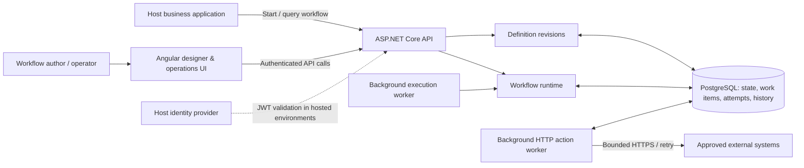
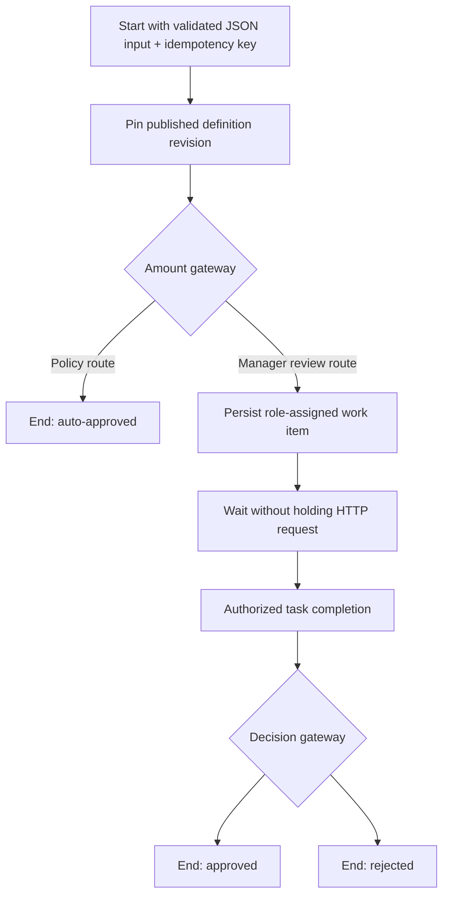

# Architecture Case Study: From a Business Request to a Durable Workflow Engine

> **Project:** [Business Workflow Engine](../../README.md) · **Stack:** ASP.NET Core / .NET 10, EF Core, PostgreSQL, Angular · **Status:** Early open-source implementation; not production-hardened or customer-validated.

## The engineering question

A business request may begin in one application, wait for a person, call another system, and finish hours or days later. During that time, the initiating HTTP request is long gone. The challenge is to make **current ownership, execution progress, the final outcome, and the path to that outcome** visible without turning the workflow engine into the system of record for purchasing, HR, or finance.

The [problem statement](../product/problem-statement.md) treats this as a product hypothesis, not a validated market gap. The initial [purchase-approval scenario](../product/first-use-case.md) provided a narrow way to examine the engineering problem; a separate [employee-leave definition](../../examples/employee-leave/workflow.json) tests whether the runtime can express another process without business-specific engine code.

**Design objective:** a self-hostable orchestration layer with versioned definitions, durable work, explicit authorization, and queryable history, while leaving business data and policy ownership with host applications.

## Constraints that shaped the design

| Requirement | Architectural implication |
| --- | --- |
| A process can outlive an HTTP call or application restart | Persist an instance's position and pending work in a database |
| Different processes have different inputs, routes, roles, and outcomes | Describe process topology and contracts in a validated definition rather than adding domain-specific columns |
| Operators need both a current answer and an explanation | Keep current relational state alongside append-only execution events |
| Repeated requests and ambiguous network failures are normal | Deduplicate start commands, track work/action attempts, and make retry semantics explicit |
| The runtime is added to existing applications | Accept host-issued identity and expose a versioned REST API |
| Early scope and operational capacity are limited | Keep one backend deployment and one relational consistency boundary |

These constraints and their trade-offs are recorded in [ADR 0001](decisions/0001-modular-monolith.md), [ADR 0002](decisions/0002-relational-state-and-history.md), and [ADR 0006](decisions/0006-definition-driven-general-purpose-runtime.md).

## Architecture at a glance

This is a **logical view**, not a microservice diagram. The API, runtime, and hosted background workers live in the same .NET application. The Angular UI is a separate frontend, and PostgreSQL is the persistence layer. Source: [application composition](../../src/server/BusinessWorkflowEngine.Api/Program.cs), [runtime](../../src/server/BusinessWorkflowEngine.Api/Workflows/WorkflowRuntimeService.cs), and [EF Core model](../../src/server/BusinessWorkflowEngine.Api/Workflows/WorkflowDbContext.cs).

## A request's lifecycle

Consider the [purchase-approval definition](../../examples/purchase-approval/workflow.json), used as a demonstration rather than a claim about real procurement policy.

1. **Definition authoring.** An author creates a graph with input/output schemas, supported node types, routing rules, and roles. The server validates it, and published revisions are immutable. See [definition contract](workflow-definition-v1.md), [validator](../../src/server/BusinessWorkflowEngine.Api/Workflows/WorkflowDefinitionDocument.cs), and [publish endpoints](../../src/server/BusinessWorkflowEngine.Api/Workflows/WorkflowDefinitionEndpoints.cs).
2. **Start.** The API validates input, selects the latest published revision, and stores a new instance tied to that revision. The combination of definition name, initiating subject, and idempotency key is unique; conflicting reuse with different input is rejected. See [StartAsync](../../src/server/BusinessWorkflowEngine.Api/Workflows/WorkflowRuntimeService.cs).
3. **Advance or wait.** The runtime executes deterministic nodes and persists steps/events. At a `userTask`, it creates a durable role-assigned work item and changes the instance to a waiting state. A background worker resumes eligible execution. See [runtime](../../src/server/BusinessWorkflowEngine.Api/Workflows/WorkflowRuntimeService.cs) and [worker](../../src/server/BusinessWorkflowEngine.Api/Workflows/WorkflowExecutionBackgroundService.cs).
4. **Human decision.** The API checks the authenticated caller's role before accepting completion, validates the completion payload, records the decision, and makes the instance ready to continue. See [work-item endpoints](../../src/server/BusinessWorkflowEngine.Api/Workflows/WorkflowInstanceEndpoints.cs).
5. **Result and evidence.** An end node persists a business outcome and mapped JSON output. Instance and event endpoints expose the current state and the execution timeline; they are not a full event-sourcing replay mechanism. See [runtime endpoints](../../src/server/BusinessWorkflowEngine.Api/Workflows/WorkflowInstanceEndpoints.cs) and [ADR 0002](decisions/0002-relational-state-and-history.md).

## Decisions, alternatives, and costs

| Decision | Why it fits the current scope | Cost accepted |
| --- | --- | --- |
| **Modular monolith over microservices** | One process and database simplify coordinated updates to instance, task, and history; no demonstrated need for independent service scaling | Components deploy together; internal boundaries require discipline. [ADR 0001](decisions/0001-modular-monolith.md) |
| **Current state + event history over full event sourcing** | Fast state queries and a readable execution trail without event replay and projection infrastructure | History is not an integration event bus or an arbitrary time-travel model. [ADR 0002](decisions/0002-relational-state-and-history.md) |
| **Versioned JSON graph over compiled workflows or immediate BPMN** | Different processes can use the same bounded executor without adding engine code for each workflow | The supported node set is deliberately limited, and schema evolution needs care. [ADR 0006](decisions/0006-definition-driven-general-purpose-runtime.md) |
| **Host-issued JWT and role claims over an internal user directory** | Existing systems own identities; the engine authorizes actions using authenticated claims | Operators must configure a compatible identity provider and stable role mappings. [ADR 0004](decisions/0004-identity-boundary.md) |
| **Configured HTTPS actions over arbitrary scripts/plugins** | A limited integration surface offers auditable destination, credential, timeout, and retry controls | No broad connector marketplace or unrestricted transformation language. [ADR 0007](decisions/0007-web-authoring-roles-and-http-integrations.md) |

### Failure semantics worth making explicit

**Duplicate start:** the API checks the idempotency key and request hash, with a database uniqueness constraint as a concurrency backstop. This is an implementation mechanism, not a substitute for an end-to-end concurrency test. [Runtime](../../src/server/BusinessWorkflowEngine.Api/Workflows/WorkflowRuntimeService.cs) · [Database model](../../src/server/BusinessWorkflowEngine.Api/Workflows/WorkflowDbContext.cs).

**Crash while waiting for a person:** work items and the workflow's current position are persisted, so the design does not require a long-lived in-memory request or process. Restart recovery is part of the intended contract but needs an exercised integration test. [Runtime](../../src/server/BusinessWorkflowEngine.Api/Workflows/WorkflowRuntimeService.cs).

**Timeout after an external side effect:** the remote system may have succeeded even if the response was lost. The HTTP worker persists attempts and retries retryable failures; it sends an `Idempotency-Key` based on the instance and node. Delivery remains **at least once**, and downstream receivers must implement idempotency for non-repeatable actions. [HTTP worker implementation](../../src/server/BusinessWorkflowEngine.Api/Workflows/WorkflowRuntimeService.cs) · [Definition contract](workflow-definition-v1.md).

**Untrusted integrations and role assignments:** definitions cannot execute arbitrary scripts. Connection base URLs must be HTTPS and host-allowlisted, stored credentials are encrypted, and role work is checked against authenticated claims. These are bounded controls, not a security certification. [Validation](../../src/server/BusinessWorkflowEngine.Api/Workflows/WorkflowDefinitionDocument.cs) · [Connections](../../src/server/BusinessWorkflowEngine.Api/Workflows/WorkflowIntegrationEndpoints.cs) · [API setup](../../src/server/BusinessWorkflowEngine.Api/Program.cs).

## What is built, and what is not yet proven

**Present in the repository:** the generic definition format and validation, publish endpoints, browser authoring UI, durable instance/step/work-item/event models, background workers, role-based task endpoints, configured HTTP actions, and two distinct example process definitions. The legacy purchase-specific path remains for compatibility. See the [README](../../README.md), [MVP scope](../product/mvp-scope.md), and linked code above.

**Not yet established:** verified recovery under process crashes, comprehensive concurrent execution and retry tests, integration tests against a real external identity provider, production load/latency measurements, operational hardening, and customer validation. The [test workflow](../../.github/workflows/tests.yml) now runs xUnit contract tests and PostgreSQL-backed API business scenarios, including simulated HTTPS actions and restart recovery. See the [verification report](../quality/verification.md) and [successful CI run](https://github.com/mehrdadbahrainy/business-workflow-engine/actions/runs/42513663051). Production identity-provider integration, load, multi-worker concurrency, and real downstream integrations remain unverified.

**Next verification priorities:** exercise a real identity provider, concurrent duplicate starts and multiple-worker claims under load, database interruptions, and crash windows between outbound HTTP side effects and persisted acknowledgements. The simulated HTTPS receiver verifies outgoing idempotency headers, not real downstream deduplication.

## The broader engineering lesson

A workflow runtime's defining responsibility is not the number of node types it supports. It is the ability to **explain and resume a business request across time, people, and system boundaries**. The decision to keep the first architecture small, persist explicit state transitions, and make external effects and identity boundaries visible is intended to make that responsibility testable.

This case study documents **design decisions and inspected implementation**, not a production success story or independently verified benchmark.

---

*Further reading: [Architecture decision records](decisions/) · [Workflow definition contract](workflow-definition-v1.md) · [MVP scope](../product/mvp-scope.md) · [Source repository](https://github.com/mehrdadbahrainy/business-workflow-engine).*
